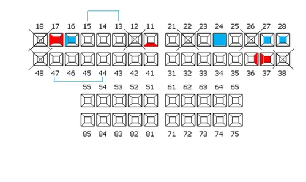

# Especificación de Dominio Odontológico: Arquitectura y Reglas del Odontograma

> **Propósito de este documento:** Servir como fuente única de verdad ( Contexto de Dominio y PRD ) para el análisis e implementación técnica del módulo de Odontograma. Contiene las normas anatómicas internacionales, la lógica geométrica de caras dentales, la convención de colores, la simbología clínica y las reglas de transición de estados e impacto financiero.

---

## 1. Concepto General en el Sistema

El odontograma no es un lienzo de dibujo libre; es una **matriz anatómica interactiva y transaccional** que representa el estado bucodental del paciente a través del tiempo. Cada registro ingresado en el odontograma debe:
1. Representar gráficamente hallazgos patológicos, tratamientos preexistentes, tratamientos planificados y tratamientos realizados.
2. Conservar la trazabilidad histórica (**Odontograma Inicial** vs. **Odontograma Actual/Evolutivo**).
3. Conectarse directamente con el **Presupuesto del Paciente** (cuando un tratamiento se marca como *Planificado*) y con el motor de **Procedimientos Realizados, Facturación y Comisiones** (cuando se marca como *Completado*).

---

## 2. Sistema de Numeración Dental (Estándar FDI - ISO 3950)

El sistema utiliza la nomenclatura internacional de **dos dígitos** de la Federación Dental Internacional (FDI):
* **Primer dígito ($\text{Cuadrante}$):** Ubicación anatómica y tipo de dentición ($1$ al $4$ para adultos/permanentes; $5$ al $8$ para niños/temporales).
* **Segundo dígito ($\text{Pieza}$):** Posición del diente desde la línea media (centro de la boca, diente $1$) hacia atrás (hacia las muelas del juicio, diente $8$ en adultos o $5$ en niños).

### 2.1 Regla de Perspectiva Visual (Espejo Clínico)
El odontograma se renderiza desde la **perspectiva del odontólogo mirando de frente al paciente**:
* El **lado izquierdo de la pantalla** corresponde al **lado derecho del paciente** (Cuadrantes $1, 5, 8, 4$).
* El **lado derecho de la pantalla** corresponde al **lado izquierdo del paciente** (Cuadrantes $2, 6, 7, 3$).
* La **línea media vertical** divide los cuadrantes derechos de los izquierdos (entre los incisivos centrales $11|21$ arriba y $41|31$ abajo).

### 2.2 Disposición Exacta de las Piezas en Pantalla (De izquierda a derecha)

```text
                       LÍNEA MEDIA (CENTRO)
                                │
   LADO DERECHO DEL PACIENTE    │    LADO IZQUIERDO DEL PACIENTE
   (Izquierda en pantalla)      │    (Derecha en pantalla)
                                │
Cuadrante 1 (Sup. Der. Adulto): │ Cuadrante 2 (Sup. Izq. Adulto):
[18][17][16][15][14][13][12][11]│[21][22][23][24][25][26][27][28]
                                │
Cuadrante 5 (Sup. Der. Niño):   │ Cuadrante 6 (Sup. Izq. Niño):
            [55][54][53][52][51]│[61][62][63][64][65]
────────────────────────────────┼──────────────────────────────── (Plano Oclusal)
Cuadrante 8 (Inf. Der. Niño):   │ Cuadrante 7 (Inf. Izq. Niño):
            [85][84][83][82][81]│[71][72][73][74][75]
                                │
Cuadrante 4 (Inf. Der. Adulto): │ Cuadrante 3 (Inf. Izq. Adulto):
[48][47][46][45][44][43][42][41]│[31][32][33][34][35][36][37][38]
```

### 2.3 Clasificación Anatómica según el Segundo Dígito
El segundo dígito determina el grupo dental y su morfología:
* **$1$ y $2$:** Incisivos (Central y Lateral) $\rightarrow$ Dientes anteriores.
* **$3$:** Canino $\rightarrow$ Diente anterior.
* **$4$ y $5$ (en adultos):** Premolares (Primero y Segundo) $\rightarrow$ Dientes posteriores. *(En niños $51$-$85$, las posiciones $4$ y $5$ son molares temporales).*
* **$6, 7$ y $8$ (en adultos):** Molares (Primero, Segundo y Tercer molar/cordal) $\rightarrow$ Dientes posteriores.

### 2.4 Modos de Visualización de la Interfaz
El odontograma debe permitir alternar entre 3 vistas:
1. **Adulto (Permanente):** Muestra únicamente los cuadrantes $1, 2, 3, 4$ ($32$ piezas).
2. **Pediátrico (Temporal/Deciduo):** Muestra únicamente los cuadrantes $5, 6, 7, 8$ ($20$ piezas).
3. **Mixto (Completo):** Muestra las $52$ piezas simultáneamente (común en pacientes de $6$ a $12$ años en recambio dental).

---

## 3. Anatomía Geométrica del Diente y Regla de Inversión de Caras

En el odontograma geométrico, cada diente se divide en **5 zonas o polígonos independientes** (`top`, `bottom`, `left`, `right`, `center`).

```text
            [ TOP ]
          ┌─────────┐
          │\       /│
          │ \┌───┐/ │
  [LEFT]  │  │CTR│  │  [RIGHT]
          │ /└───┘\ │
          │/       \│
          └─────────┘
           [ BOTTOM ]
```

### 3.1 Definición de las Superficies Anatómicas
* **`V` (Vestibular):** Cara del diente que mira hacia afuera (hacia los labios o mejillas).
* **`P` (Palatina):** Cara interna de los **dientes superiores** (mira hacia el paladar).
* **`L` (Lingual):** Cara interna de los **dientes inferiores** (mira hacia la lengua).
* **`M` (Mesial):** Cara lateral que **se acerca a la línea media** (centro de la boca).
* **`D` (Distal):** Cara lateral que **se aleja de la línea media** (hacia el fondo de la boca).
* **`O` (Oclusal):** Superficie central de masticación en **dientes posteriores** (segundo dígito $4, 5, 6, 7, 8$).
* **`I` (Incisal):** Borde cortante central en **dientes anteriores** (segundo dígito $1, 2, 3$).

### 3.2 Matriz de Mapeo Geométrico por Cuadrante (REGLA CRÍTICA DE IMPLEMENTACIÓN)
> **Atención:** Las caras `Mesial`/`Distal` y `Vestibular`/`Palatina-Lingual` **se invierten** dependiendo del cuadrante en el que se encuentre el diente. Nunca se debe programar `left = Mesial` de forma fija.

| Cuadrantes | Ubicación | Polígono `TOP` (Arriba) | Polígono `BOTTOM` (Abajo) | Polígono `LEFT` (Izquierda) | Polígono `RIGHT` (Derecha) | Polígono `CENTER` (Centro) |
| :--- | :--- | :---: | :---: | :---: | :---: | :---: |
| **Cuadrantes $1$ y $5$** | Superior Derecho | `V` (Vestibular) | `P` (Palatina) | `D` (Distal) | `M` (Mesial) | `I` (piezas $1$-$3$) / `O` (piezas $4$-$8$) |
| **Cuadrantes $2$ y $6$** | Superior Izquierdo | `V` (Vestibular) | `P` (Palatina) | `M` (Mesial) | `D` (Distal) | `I` (piezas $1$-$3$) / `O` (piezas $4$-$8$) |
| **Cuadrantes $4$ y $8$** | Inferior Derecho | `L` (Lingual) | `V` (Vestibular) | `D` (Distal) | `M` (Mesial) | `I` (piezas $1$-$3$) / `O` (piezas $4$-$8$) |
| **Cuadrantes $3$ y $7$** | Inferior Izquierdo | `L` (Lingual) | `V` (Vestibular) | `M` (Mesial) | `D` (Distal) | `I` (piezas $1$-$3$) / `O` (piezas $4$-$8$) |

---

## 4. Código de Colores y Semántica Visual

En odontología clínica, **el color representa el estado del hallazgo o tratamiento**, no el tipo de material:

| Color | Valor Hex Sugerido | Significado Clínico | Estados Asociados (`status`) | Impacto Financiero / Sistema |
| :--- | :---: | :--- | :--- | :--- |
| **Blanco / Neutro** | `#FFFFFF` | Superficie o pieza sana sin hallazgos. | Sin registro activo. | Ninguno. |
| **Rojo** | `#EF4444` | **1. Patología / Hallazgo Activo:** Caries, fractura, infección, restauración filtrada/defectuosa.<br>**2. Tratamiento Planificado (Por hacer):** Cualquier procedimiento diagnosticado pendiente de ejecución. | `finding` (Hallazgo patológico)<br>`planned` (Planificado / En presupuesto) | Si es `planned`, se vincula al **Presupuesto** del paciente como pendiente de cobro/ejecución. |
| **Azul** | `#3B82F6` | **Tratamiento Realizado en la Clínica:** Procedimientos ejecutados exitosamente (resinas, coronas, endodoncias, extracciones realizadas). | `completed` (Realizado) | Dispara registro de **Procedimiento Ejecutado**, **Cobro en Caja** y **Asiento de Comisión** (Doctor/Asistente). |
| **Verde o Gris Oscuro** | `#10B981` / `#475569` | **Condición o Tratamiento Preexistente (Antiguo):** Trabajos en buen estado o ausencias dentales con las que el paciente ya llegó en su primera consulta (hechos en otra clínica). | `pre_existing` (Preexistente) | **Cero impacto financiero.** Solo valor clínico/histórico; nunca genera cobro ni comisión en la clínica. |

> **Nota sobre Restauraciones Defectuosas (Borde Rojo + Relleno Azul/Verde):** Cuando un paciente trae un empaste antiguo o corona que tiene filtración o caries recurrente, suele representarse con relleno azul/verde y **borde rojo** (o directamente como hallazgo patológico en rojo con nota clínica).

---

## 5. Niveles de Alcance (Scope) y Reglas de Afectación

Los registros del odontograma se clasifican en **4 niveles de alcance (`scope`)** según qué parte de la anatomía bucal afectan:

### Nivel 1: Por Superficie (`scope = 'surface'`)
Afecta de $1$ a $5$ caras de un mismo diente.
* **Ejemplos:** Caries, Resina Compuesta, Amalgama, Incrustación, Sellante de fosas, Carilla (afecta cara `V`).
* **Regla de Superficies Compuestas (Crítica para cobros):**
  Una caries o restauración puede abarcar varias caras contiguas del mismo diente en un solo acto clínico:
  * **Simple ($1$ cara):** Ej. `["O"]` (Oclusal).
  * **Compuesta ($2$ caras):** Ej. `["O", "M"]` (Ocluso-Mesial `OM`) o `["O", "D"]` (Ocluso-Distal `OD`).
  * **Compleja ($3$ o más caras):** Ej. `["M", "O", "D"]` (`MOD`).
  * **Comportamiento en Base de Datos:** Aunque se pinten $2$ o $3$ polígonos en el SVG del diente, deben pertenecer a **una sola transacción clínica** (`surfaces = ["M", "O", "D"]`) para que genere **1 solo cobro** y **1 sola comisión** del servicio correspondiente (ej. *"Resina Compuesta 3 Caras"*), y no $3$ cobros separados.

### Nivel 2: Por Pieza Completa (`scope = 'tooth'`)
Afecta a la totalidad del diente (corona clínica y/o raíz) y se dibuja como una capa SVG superpuesta (`overlay`) sobre el esquema de las 5 caras.
* **Ejemplos:** Exodoncia (Extracción), Diente Ausente, Corona Completa, Endodoncia (Tratamiento de conducto), Implante Dental, Diente Retenido/Impactado, Perno/Muñón.

### Nivel 3: Por Rango / Multi-Pieza (`scope = 'range'`)
Afecta desde una pieza inicial (`tooth_number`) hasta una pieza final (`bridge_to_tooth`) dentro del mismo arco dental.
* **Ejemplos:** Puente Fijo (ej. desde pieza $14$ hasta pieza $16$, donde $14$ y $16$ son pilares y $15$ es póntico/ausente), Férula periodontal, Prótesis parcial removible.

### Nivel 4: Por Arcada o Boca Completa (`scope = 'arch'` o `'mouth'`)
Procedimientos generales que no se asocian a un polígono de un diente individual, sino a la cavidad bucal completa o a un maxilar completo (Superior / Inferior).
* **Ejemplos:** **Profilaxis (Limpieza dental)**, Raspado y Alisado Radicular por cuadrante/arcada, Aplicación de Flúor, Blanqueamiento Dental, Ortodoncia, Prótesis Total (Dentadura completa).
* **Comportamiento en UI:** El odontograma debe contar con un botón de acción general (`+ Procedimiento de Boca Completa / Arcada`) para registrar estos servicios en el expediente sin obligar al usuario a hacer clic en los $32$ dientes.

---

## 6. Catálogo de Simbología Visual y Reglas de Exclusión

Esta tabla define cómo debe renderizarse cada condición en el SVG del diente y qué restricciones aplica sobre la pieza:

| Condición / Tratamiento | Código (`condition_code`) | Alcance (`scope`) | Representación Gráfica en el Diente (SVG) | Color según Estado | Regla de Exclusión / Afectación sobre la Pieza |
| :--- | :--- | :---: | :--- | :--- | :--- |
| **Caries** | `caries` | `surface` | Relleno sólido del polígono de la(s) cara(s) afectada(s). | **Rojo** (`finding`) | Al tratarse con una restauración (`resin`, `amalgam`, `inlay`), la caries pasa a estado `superseded` (reemplazada). |
| **Resina / Obturación** | `resin` | `surface` | Relleno sólido del polígono de la(s) cara(s) tratada(s). | **Rojo** (`planned`)<br>**Azul** (`completed`)<br>**Verde** (`pre_existing`) | Reemplaza patologías previas en las mismas caras de ese diente. |
| **Sellante de Fosas** | `sealant` | `surface` | Letra **`S`** o entramado sobre la cara Oclusal (`O`). | **Rojo** (`planned`)<br>**Azul** (`completed`) | Solo permitido en caras `O` de premolares y molares. |
| **Fractura Dental** | `fracture` | `tooth` o `surface` | Línea en **zig-zag (rayo)** roja cruzando la pieza o cara. | **Rojo** (`finding`) | Requiere tratamiento restaurador, endodóntico o exodoncia. |
| **Exodoncia (Extracción)** | `extraction` | `tooth` | **`X` grande** superpuesta sobre todo el diente. | **Rojo** (`planned` = extracción indicada)<br>**Azul** (`completed` = extraído en clínica) | **Regla de Bloqueo:** Si `extraction` está en estado `completed`, el diente queda inactivo para recibir nuevos tratamientos de superficie o coronas. |
| **Diente Ausente** | `missing` | `tooth` | **`X` grande** (o diente atenuado con opacidad al $20\%$ y líneas cruzadas). | **Azul** o **Verde/Gris** (`pre_existing`) | **Regla de Bloqueo:** Diente inexistente. Solo admite planificación de `implant` (Implante) o ser parte de un `bridge` (Puente). |
| **Endodoncia (Conducto)** | `endodontics` | `tooth` | **Línea vertical gruesa** en el eje central de la pieza (o triángulo en el centro/raíz). | **Rojo** (`planned`)<br>**Azul** (`completed`)<br>**Verde** (`pre_existing`) | Es compatible con tratamientos de superficie (`resin`) y con `crown` (Corona) en el mismo diente. |
| **Corona Completa** | `crown` | `tooth` | **Círculo o borde perimetral grueso** que rodea todo el contorno del diente. | **Rojo** (`planned`)<br>**Azul** (`completed`)<br>**Verde** (`pre_existing`) | Si pasa a `completed`, cubre las 5 caras del diente (reemplaza hallazgos superficiales previos). |
| **Implante Dental** | `implant` | `tooth` | Símbolo de **tornillo / espiral** o sigla **`IMP`** en la base del diente. | **Rojo** (`planned`)<br>**Azul** (`completed`)<br>**Verde** (`pre_existing`) | Puede colocarse sobre piezas que estaban marcadas como `missing` o `extraction` (`completed`). |
| **Puente Fijo** | `bridge` | `range` | Círculos en los dientes pilares conectados por una **línea horizontal continua** sobre los dientes intermedios. | **Rojo** (`planned`)<br>**Azul** (`completed`)<br>**Verde** (`pre_existing`) | Conecta `tooth_number` (inicio) con `bridge_to_tooth` (fin) en el mismo arco (superior o inferior). |

---

## 7. Máquina de Estados y Evolución Histórica del Odontograma

Por requerimiento clínico y médico-legal, **ningún diagnóstico inicial debe borrarse físicamente (`DELETE`) cuando el paciente recibe el tratamiento**. El sistema debe manejar una máquina de estados que permita reconstruir la historia del diente:

```text
[1. DIAGNÓSTICO INICIAL]
   ├──► pre_existing (Trabajo antiguo de otra clínica) ──► Permanece en Verde/Gris (No cobrable)
   └──► finding (Patología activa, ej. Caries en 16-O) ──► Se pinta en ROJO
            │
            ▼ (Cuando se agrega un tratamiento para curar esa patología)
[2. PLANIFICACIÓN]
   └──► Se crea registro de Tratamiento (ej. Resina en 16-O) en estado `planned` (ROJO)
            │
            ▼ (Cuando el doctor ejecuta el tratamiento en el sillón)
[3. EJECUCIÓN CLÍNICA]
   ├──► El Tratamiento (Resina 16-O) pasa a estado `completed` ──► Se pinta en AZUL
   └──► La Patología original (Caries 16-O) pasa automáticamente a `superseded` (Histórico reemplazado)
```

### 7.1 Regla de Renderizado por Capas (Prioridad Visual en un mismo Diente)
Un mismo diente (ej. pieza $26$) puede tener varios registros activos al mismo tiempo si son clínicamente compatibles (por ejemplo: una **Endodoncia realizada** en la raíz + una **Caries** en la cara Mesial + una **Resina** en la cara Oclusal).
Para renderizar cada diente en pantalla, el motor visual debe:
1. Filtrar solo los registros cuyo estado sea `finding`, `pre_existing`, `planned` o `completed` (ignorando los `superseded` y `cancelled`, a menos que el usuario active el filtro *"Ver Odontograma Inicial"*).
2. Para cada una de las 5 caras (`V`, `P/L`, `M`, `D`, `O/I`), tomar el registro de `scope = 'surface'` más reciente que incluya esa cara en su array `surfaces`.
3. Renderizar encima las capas de `scope = 'tooth'` (Endodoncia, Corona, Exodoncia, Implante), permitiendo que coexistan símbolos compatibles (ej. línea vertical de Endodoncia + círculo externo de Corona).

---

## 8. Reglas de Interacción con el Flujo de Negocio (Citas, Facturación y Comisiones)

El odontograma debe operar bajo dos modos de interacción en la interfaz de usuario:

### Modo A: Diagnóstico Rápido (1 Clic - Sin impacto en Caja)
* Usado durante la evaluación inicial del paciente.
* El doctor o la asistente selecciona en una paleta rápida un hallazgo (`Caries`, `Ausente`, `Restauración Preexistente`, `Endodoncia Preexistente`) y hace clic en las caras o dientes.
* **Regla:** Guarda los registros con `status = 'finding'` o `status = 'pre_existing'`. **No requiere seleccionar un servicio del catálogo de precios ni dispara cobros ni comisiones.**

### Modo B: Planificación y Ejecución de Tratamientos (Conectado al Catálogo)
* Usado para presupuestar o registrar procedimientos realizados en la clínica.
* Al seleccionar una pieza (y sus caras) o el botón de *Boca Completa*, el modal solicita:
  1. **Condición/Acción Visual:** (Ej. Resina, Exodoncia, Corona, Profilaxis).
  2. **Servicio del Catálogo (`service_catalog_id`):** Vincula el acto con su precio base y sus reglas de comisión configuradas.
  3. **Personal Interviniente:** `dentist_id` (Doctor ejecutor) y `assistant_id` (Asistente dental en el cubículo).
  4. **Estado de Ejecución (`planned` vs `completed`):**
     * Si se guarda como **`planned` (Planificado):** Se pinta en **Rojo** y se añade como ítem pendiente en el **Presupuesto / Plan de Tratamiento** del paciente.
     * Si se guarda como **`completed` (Realizado)** (o cuando un ítem `planned` cambia a `completed`):
       1. Cambia su representación en el odontograma a color **Azul**.
       2. Marca como `superseded` cualquier patología (`finding`) previa en esa misma pieza/superficie.
       3. Crea automáticamente un registro en `performed_procedures` con el precio del servicio, el doctor y la asistente.
       4. Dispara el cálculo de comisiones (`commission_entries`) para el doctor y la asistente según las reglas vigentes de la clínica.

---

## 9. Esquema de Datos de Referencia para la Entidad `odontogram_entries`

| Campo | Tipo de Dato | Nulable | Descripción y Reglas |
| :--- | :--- | :---: | :--- |
| `id` | `BIGINT` (PK) | No | Identificador único del registro. |
| `patient_id` | `FOREIGN KEY` | No | Paciente al que pertenece el odontograma. |
| `branch_id` | `FOREIGN KEY` | No | Sucursal donde se registró el hallazgo o tratamiento. |
| `tooth_number` | `TINYINT UNSIGNED` | Sí | Número FDI ($11$-$48$ o $51$-$85$). Es `NULL` únicamente cuando `scope` es `'mouth'` o `'arch'` (ej. Profilaxis). |
| `arch` | `VARCHAR(15)` | Sí | `'upper'`, `'lower'` o `'full'` cuando `scope` es `'arch'` o `'mouth'`. |
| `scope` | `VARCHAR(20)` | No | Valores permitidos: `'surface'`, `'tooth'`, `'range'`, `'arch'`, `'mouth'`. |
| `surfaces` | `JSON` | Sí | Array de caras anatómicas afectadas cuando `scope = 'surface'`.Valores posibles: `["V", "P", "L", "M", "D", "O", "I"]`. |
| `bridge_to_tooth` | `TINYINT UNSIGNED` | Sí | Pieza final cuando `scope = 'range'` (ej. puente desde `tooth_number = 14` hasta `bridge_to_tooth = 16`). |
| `condition_code` | `VARCHAR(40)` | No | Identificador gráfico: `'caries'`, `'resin'`, `'amalgam'`, `'sealant'`, `'fracture'`, `'extraction'`, `'missing'`, `'endodontics'`, `'crown'`, `'implant'`, `'bridge'`, `'prophylaxis'`. |
| `status` | `VARCHAR(30)` | No | `'finding'` (Rojo), `'pre_existing'` (Verde/Gris), `'planned'` (Rojo), `'completed'` (Azul), `'superseded'` (Oculto en vista actual), `'cancelled'`. |
| `service_catalog_id` | `FOREIGN KEY` | Sí | Obligatorio cuando `status` es `'planned'` o `'completed'`. `NULL` en hallazgos iniciales. |
| `performed_procedure_id` | `FOREIGN KEY` | Sí | Se vincula automáticamente cuando `status = 'completed'`. |
| `appointment_id` | `FOREIGN KEY` | Sí | Cita en la que se diagnosticó o ejecutó el procedimiento. |
| `dentist_id` | `FOREIGN KEY` | Sí | Odontólogo que diagnosticó o realizó el tratamiento. |
| `assistant_id` | `FOREIGN KEY` | Sí | Asistente dental que participó en el procedimiento. |
| `notes` | `TEXT` | Sí | Observaciones clínicas específicas de la pieza o tratamiento. |
| `created_at` / `updated_at` | `TIMESTAMP` | No | Fechas de creación y actualización para línea de tiempo evolutiva. |



